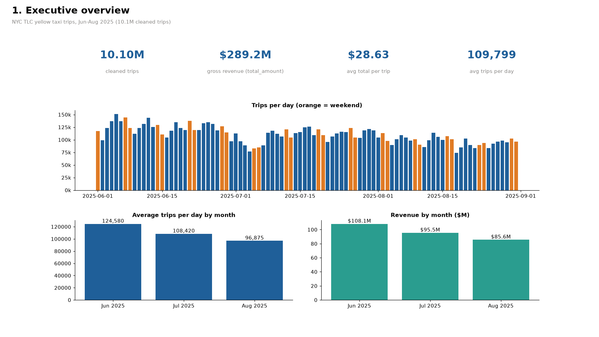

# NYC Taxi Demand Analytics

When and where do people take yellow cabs in New York, which trips actually make money, and how do riders tip?

I worked through three months of real NYC TLC yellow taxi records (**June to August 2025, 11.8M raw trips, 10.1M after cleaning**) end to end: Python cleaning and EDA, a DuckDB star schema with 14 business queries, an Excel KPI workbook, and a four-page Power BI project.

**Demo:** [charts walkthrough (32 s)](./artifacts/charts-walkthrough.mp4)



## The problem

A fleet operator or a city planner looking at taxi data usually wants the same handful of answers:

- When is demand highest, and how different are weekdays and weekends?
- Which pickup zones and airports drive volume and revenue?
- Which trip lengths earn the most per mile and per minute?
- How does tipping differ by payment type and time of day?
- Is volume growing or shrinking month to month?

## Data

- **Trips:** TLC yellow taxi trip records, monthly parquet files for 2025-06, 2025-07 and 2025-08 from the [TLC trip record page](https://www.nyc.gov/site/tlc/about/tlc-trip-record-data.page).
- **Zones:** `taxi_zone_lookup.csv` from the same page (265 zones, borough and service zone).

Raw files are about 200 MB and are not in the repo. `scripts/download_data.py` fetches them into `data/raw/`.

### Cleaning

Rules are applied in order; each row is counted against the first rule it fails (`data/processed/cleaning_log.csv`).

| Step | Rows left | Dropped |
|---|---:|---:|
| Raw rows (3 files) | 11,796,014 | |
| Pickup inside Jun-Aug 2025 | 11,795,991 | 23 |
| Valid pickup/dropoff zone (1-263) | 11,698,973 | 97,018 |
| Duration 1-180 min | 11,389,892 | 309,081 |
| Distance 0.1-100 mi | 11,061,518 | 328,374 |
| Fare $3-$500 (meter drop is $3) | 10,330,580 | 730,938 |
| No negative tips/tolls/extras, total >= fare | 10,330,390 | 190 |
| Average speed under 70 mph | 10,329,605 | 785 |
| Passenger count missing or 1-6 | 10,272,514 | 57,091 |
| Rate code missing or valid (drops code 99) | **10,101,536** | 170,978 |

85.6% of raw rows survive. Most of the fare drop is negative fares (783,844 raw rows below zero, i.e. refunds and voids).

## Approach

| Layer | What's there |
|---|---|
| Python | `scripts/` download, clean, build warehouse, run queries, export for Power BI, charts, Excel. `notebooks/01_cleaning_and_eda.ipynb` covers raw data problems, the cleaning log, distributions, hourly demand, payment mix and month trend. |
| SQL | `sql/schema.sql` builds a DuckDB star schema: `fact_trips` (10.1M rows) with `dim_zone`, `dim_date`, `dim_time`, `dim_payment`. `sql/queries/` has 14 business queries, results saved as CSV in `sql/results/`. |
| Excel | `excel/nyc_taxi_kpis.xlsx`: KPI summary, month trend, weekday x hour pivot (colour scale), weekday vs weekend, top zones, airports, payment and tips, distance bands, daily trips and the cleaning log, with native Excel charts. |
| Power BI | `dashboard/NycTaxiDemand.pbip`: TMDL semantic model with the same star schema, 5 relationships (dropoff zone is an inactive relationship used through `USERELATIONSHIP`), 25 DAX measures (`dashboard/DAX_MEASURES.md`) and four pages: Executive Overview, Demand by Time, Zones & Airports, Revenue & Tips. |
| Charts | `screenshots/charts/` four chart pages made with matplotlib from the same query results, laid out like the report pages. These are Python charts, not Power BI screenshots. |

## Key findings

All numbers are from the cleaned trips, Jun-Aug 2025.

- **Scale:** 10.10M trips, **$289.2M** charged (total_amount), **$28.63** per trip on average, about **109,800 trips a day**. Median trip is just 1.98 miles; average 3.55 mi and 16.6 min.
- **Summer slide:** trips per day fell from **124,580 in June to 108,420 in July (-10.1%) and 96,875 in August (-10.6%)**. Revenue went $108.1M -> $95.5M -> $85.6M. The five busiest days were all in June (peak: Thu 5 June, 150,914 trips); the quietest were Mon 18 Aug (73,984) and 4 July (76,592).
- **Peak hours:** the busiest hour is **18:00** on both weekdays (7,345 trips/day) and weekends (6,918). Weekday traffic crawls at **10-11 mph** from 9:00 to 13:00 versus 19-23 mph overnight.
- **Weekday vs weekend:** almost identical volume per day (109,815 vs 109,761), but weekend trips are longer (3.85 vs 3.43 mi) and faster (14.2 vs 12.2 mph). Wednesday is the busiest weekday (117,966/day), Monday the quietest (97,420).
- **Manhattan dominates:** 80.0% of trips start and end in Manhattan. JFK is the single largest pickup zone (473,813 trips, 4.7%), ahead of Midtown Center (450,607).
- **Airports punch above their weight:** JFK and LaGuardia pickups are **7.6% of trips but 19.6% of revenue**. A JFK pickup averages $78.41, 15.2 mi and 43.6 min.
- **Short trips earn most per mile:** trips under 1 mile bring **$21.64 per mile** vs $4.54 for 20+ mile trips. Per minute the gap is smaller ($2.32 vs $1.88) and 2-5 mi trips are the weakest at $1.50/min.
- **Tipping:** credit card is 65.6% of trips; card riders tip **22.9% of the fare** and 94.7% of card trips carry a tip. Card tip rates peak at **24.1% around 18:00** and bottom out near 21% overnight. Cash tips are not recorded at all (0.0%), so overall tip figures understate real tipping.
- **Data gap worth knowing:** 22.7% of cleaned trips have payment type 0 (flex fare / not recorded), with no rate code or passenger count. They're kept for volume and revenue but are effectively missing for tip analysis.
- **Congestion fee:** 82.6% of Manhattan pickups paid the CBD congestion relief zone fee; $5.73M in CBD fees was collected across all trips.

## How to run

```bash
pip install -r requirements.txt
python scripts/download_data.py          # ~200 MB into data/raw/
python scripts/clean_trips.py            # data/processed/trips_clean.parquet + cleaning_log.csv
python scripts/build_warehouse.py        # data/warehouse/nyc_taxi.duckdb
python scripts/run_queries.py            # sql/results/*.csv
python scripts/export_powerbi_data.py    # data/powerbi/
python scripts/make_charts.py            # screenshots/charts/*.png
python scripts/build_excel.py            # excel/nyc_taxi_kpis.xlsx
```

Power BI: open `dashboard/NycTaxiDemand.pbip` in Power BI Desktop (developer mode / PBIP enabled), set the `DataFolder` parameter to your local `data\powerbi` folder and refresh. The fact table loads `fact_trips.parquet` (full 10.1M rows, built by the export script) when it exists and falls back to the committed 200k-row random sample `fact_trips_sample.parquet` otherwise, so totals on the sample are about 2% of the full numbers while rates and averages stay close.

## Repo structure

```
data/
  processed/       cleaning log, daily and weekday x hour aggregates
  powerbi/         dimension CSVs + 200k-trip fact sample for Power BI
dashboard/         Power BI project (.pbip, TMDL model, report pages, DAX_MEASURES.md)
excel/             KPI workbook
notebooks/         cleaning checks and EDA
scripts/           pipeline steps
sql/
  schema.sql       star schema
  queries/         14 business queries
  results/         query output as CSV
screenshots/charts chart pages (matplotlib)
artifacts/         charts walkthrough video
```

## Notes and limits

- Three summer months only, so the monthly decline could be seasonal; I haven't compared against other years.
- Tip figures are recorded tips only. Cash and payment type 0 trips show near zero.
- The Power BI project follows the PBIP/TMDL format, but I haven't opened this one in Power BI Desktop yet, so there are no Power BI screenshots here. The chart pages are from Python.
